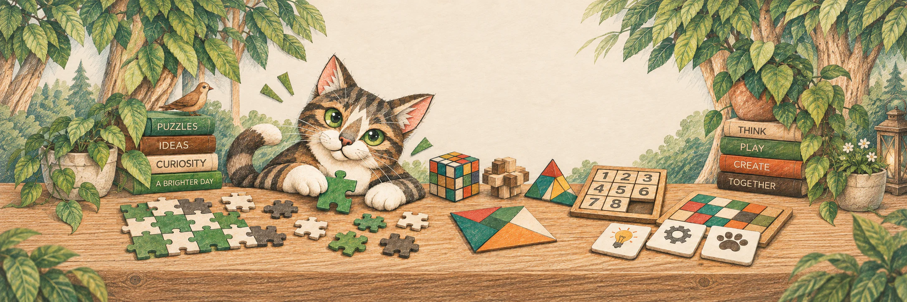

# Сергей Филиппов · Sergey Filippov

### 🎮 Разработчик игр и приложений · 4iuaCraft Studios

**От карандашного наброска — до игры на вашем телефоне.**

[🌐 Сайт студии](https://4iuacraft.com) · [📖 Дневник разработки](https://4iuacraft.com/ru/journal) · [✉️ Написать мне](mailto:support@4iuacraft.com)

🧩 Бумажные миры &nbsp; · &nbsp; 📐 Новые головоломки &nbsp; · &nbsp; ♟️ Честные партии

---

## 🕹️ Во что играем?

### 🧩 Paperlore: Jigsaw

> **Бумажные миры, которые собираются по кусочкам.**

Спокойная сборка в своём темпе: настоящие детали пазла и коллекция сюжетов.

**🟢 Статус: выпущена** &nbsp; · &nbsp; 📱 Android &nbsp; · &nbsp; 📴 Офлайн

🚫 Без рекламы &nbsp; · &nbsp; 💛 Без встроенных покупок

- **Уже можно играть:** первый выпуск 1.0.0 опубликован 3 октября 2026.
- **В мастерской — 1.1:** пять новых категорий и новые иллюстрации прежнего каталога. Рендеры проходят отбор и проверку; дата выхода ещё не объявлена.

**[▶ Скачать в RuStore](https://www.rustore.ru/catalog/app/com.sergfila.puzzles)** &nbsp; · &nbsp; [🎨 Шоурум](https://github.com/sergfila/paperlore-showroom) &nbsp; · &nbsp; [📰 Что меняется в 1.1](https://4iuacraft.com/ru/journal/jigsaw-update-1-1-in-the-workshop)

---

### 📐 Paperlore: Tangram

> **Геометрические детали, из которых вырастает история.**

Собираем силуэты и ищем образ игры-книги: её развороты постепенно наполняются цветными бумажными аппликациями.

**🟡 Статус: в разработке** &nbsp; · &nbsp; 📱 Android &nbsp; · &nbsp; 🧪 Тестовая версия

🔄 Поворот и отражение &nbsp; · &nbsp; 📐 Разные наборы деталей

- **Уже пробуем:** перенос, поворот, отражение, отмену и наборы из **1, 4 и 10 деталей**. Тестовая сборка на Pixel 7; проверка новых сцен продолжается.
- **Впереди:** книжные миры, история и дополнительные механики. Выпуск пока не объявлен.

**[🔎 Заглянуть в шоурум](https://github.com/sergfila/tangram-showroom)** &nbsp; · &nbsp; [📖 Первые эскизы и замысел](https://4iuacraft.com/ru/journal/paperlore-tangram-a-new-paper-story)

---

### ♟️ Русские шашки

> **Побеждает игра, а не кошелёк.**

Честная онлайн-игра без рекламы, донатов и платных преимуществ.

**🟡 Статус: в разработке** &nbsp; · &nbsp; 📱 Android &nbsp; · &nbsp; 🌐 Онлайн

🚫 Без рекламы &nbsp; · &nbsp; 💛 Без донатов и платных преимуществ

- **Готовим первый выпуск:** Android-версия 1.0.0 собрана и направлена в RuStore; публичный выпуск пока не подтверждён.
- **В игре:** рейтинг Elo и серверная проверка партий. Клиент — React Native и Expo, связь — защищённые WebSocket-соединения.

**[♟️ Сайт игры](https://russkieshashki.ru)** &nbsp; · &nbsp; [🎨 Публичная презентация](https://github.com/sergfila/russian-checkers-showcase)

---

## 🛠️ На рабочем столе · 11 октября 2026

| 🧩 Jigsaw 1.1 | 📐 Tangram |
|---|---|
| Расширяем каталог и уточняем бумажный стиль: меньше шума, читаемые формы и слои. На сайте — сравнения «до и после». | Проверяем асимметрию, отражение и разные наборы фигур. Сначала управление и геометрия, затем — игра-книга. |

[📰 Читать новости мастерской →](https://4iuacraft.com/ru/journal)

## ✏️ За играми — человек

4iuaCraft Studios — небольшая независимая студия. Делаем игры с понятными правилами, вниманием к деталям и уважением к игроку. Мне интересен весь путь: эскиз, архитектура, удобное управление, надёжное сохранение и выпуск.

Codex и другие ИИ-инструменты помогают в разработке. Решения проверяю кодом, тестами и на реальном устройстве.

<strong>🧰 Открыть ящик с инструментами — технологии и где они работают</strong>

| Часть продукта | Стек | Где применяю |
|---|---|---|
| 📱 **Мобильная игра** | `TypeScript` · `React Native` · `Expo` | Игровые экраны, жесты, навигация и Android-сборки |
| 🎨 **Графика и сохранение** | `React Native Skia` · `SQLite` | Отрисовка и взаимодействие с деталями Paperlore, офлайн-сессии |
| ⚡ **Онлайн-игра** | `Node.js` · `Fastify` · `WebSocket` · `PostgreSQL` | Сервер партий, синхронизация ходов и рейтинг «Русских шашек» |
| 🌐 **Сайты проектов** | `React` · `Next.js` | Сайт студии и страницы игр |
| 🧪 **Качество и выпуск** | `Jest` · `Docker` · `GitHub Actions` | Автоматические проверки, инфраструктура и подготовка релизов |

<strong>📚 Что можно найти в публичных шоурумах?</strong>

Историю создания игр, эскизы, эксперименты и принятые решения. Исходный код игр остаётся закрытым; внутреннюю реализацию не публикуем.

---

### Сделано человеком для людей 💛

Есть идея, вопрос или отзыв об игре? Буду рад письму.

**[✉️ support@4iuacraft.com](mailto:support@4iuacraft.com)** &nbsp; · &nbsp; [🌐 4iuacraft.com](https://4iuacraft.com)

